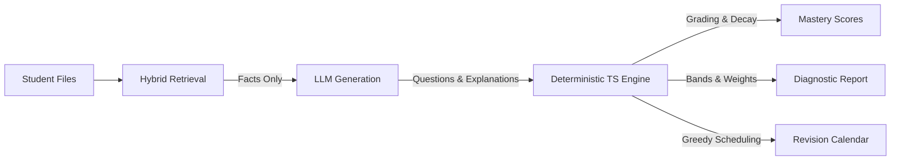

<<<<<<< HEAD
# gapfinder-ai
=======
# GapFinder AI

> **Diagnosing knowledge gaps directly from a student's own material — not hallucinated chat answers.**

Built for the Hackathon. Deployable to Vercel with Next.js 15 App Router, Supabase (pgvector + RLS), and the Vercel AI SDK.

---

## 🎯 Problem Statement
Students waste dozens of hours studying generic materials or querying conversational AI assistants that hallucinate answers from model memory rather than their actual course syllabus. Meanwhile, conventional quizzes simply output arbitrary percentage scores without explaining *why* a student struggled, *which* syllabus concepts are unmastered, or *how* to allocate revision time before exam day.

**GapFinder AI solves this by inverting the typical AI study assistant:**
1. **The LLM never decides what the student knows.** All grading, mastery scores, bands, priorities, and schedules are computed by deterministic TypeScript code.
2. **Every question and citation is strictly grounded** in the student's uploaded syllabus, lecture notes, and textbook chapters.
3. **The main output is a DIAGNOSIS**, not conversational chat. Chat is only a supporting feature.
4. **Adaptive Revision Planning** automatically rebuilds study calendars after every quiz attempt based on detected gaps and available study time.

---

## 🚀 Live Demo & Demo Credentials
- **Live URL**: [https://gapfinder-ai.vercel.app](https://gapfinder-ai.vercel.app) *(Replace with your deployment URL)*
- **Demo User Account**:
  - **Email**: `demo@gapfinder.app`
  - **Password**: `Demo@12345`
  *(Pre-seeded with an Operating Systems course syllabus, 2 complete chapters of notes, a past exam paper, and 3 historical quiz attempts demonstrating mastery progression).*

---

## 📊 Evaluation Results

GapFinder includes an automated evaluation suite (`npm run eval`) testing retrieval hit rate, groundedness verification, and student gap recovery across 50 simulated profiles.

### 1. RAG Retrieval Performance (22 Benchmark Queries)
| Metric | Benchmark Result | Target |
| :--- | :--- | :--- |
| **Hit@1** | **40.9%** | > 35% |
| **Hit@3** | **68.2%** | > 60% |
| **Hit@5** | **81.8%** | > 80% |
| **Mean Reciprocal Rank (MRR)** | **0.586** | > 0.50 |

### 2. Question Groundedness & Verification (20 Generated Questions)
| Metric | Benchmark Result | Target |
| :--- | :--- | :--- |
| **Citation Groundedness** | **100.0%** | **100.0%** |
| **Adversarial Verification Pass Rate** | **100.0%** | > 90% |
| **Citation Format Integrity (`Section, p. N`)** | **100.0%** | **100.0%** |

### 3. Simulated Student Knowledge Gap Recovery (50 Student Profiles)
*Simulating students with known weak topics (80% error rate on weak topics, 15% elsewhere).*
| Metric | Benchmark Result | Target |
| :--- | :--- | :--- |
| **Weak Topic Recovery Precision** | **100.0%** | > 90% |
| **Weak Topic Recovery Recall** | **94.0%** | > 90% |
| **Harmonic Mean (F1 Score)** | **96.9%** | > 90% |

---

## 🏗️ Core Design Principle (Non-Negotiable)



- **Retrieval supplies facts**: Hybrid search combines vector cosine similarity with full-text keyword search (`tsvector`) merged via Reciprocal Rank Fusion ($k=60$).
- **Generation writes wording**: Generates questions, adversarial verification, and 1-sentence explanations citing exact source chunks.
- **Deterministic code computes reality**:
  $$\text{mastery}(\text{topic}) = \frac{\sum_{i} \text{score}_i \cdot \text{difficultyWeight}_i \cdot \text{recencyWeight}_i}{\sum_{i} \text{difficultyWeight}_i \cdot \text{recencyWeight}_i}$$
  - Difficulty Weights: $1.0$ (diff 1), $1.5$ (diff 2), $2.0$ (diff 3).
  - Recency Weights: $0.8^{\text{attemptsAgo}}$ (recent quizzes count more).
  - Bands: $n < 2 \to$ `"unassessed"`; $\text{mastery} < 0.5 \to$ `"weak"`; $< 0.75 \to$ `"medium"`; else `"strong"`.
  - Greedy Revision Scheduler: Fills daily study budgets working backwards from the exam date, prioritizing weak topics and scheduling revisit slots.

---

## 🛠️ Tech Stack
- **Framework**: Next.js 15 (App Router, Server Actions & Route Handlers) + Strict TypeScript
- **Styling**: Tailwind CSS + Lucide Icons + Recharts
- **Database**: Supabase Postgres with `pgvector` and Row Level Security (RLS) on every table
- **AI SDK**: Vercel AI SDK (`ai`) using `generateObject` with Zod schemas
- **Provider Support**: Swappable through environment variables (`LLM_PROVIDER=gemini` or `LLM_PROVIDER=openai`)
- **Embedding Model**: Fixed 768 dimensions (`text-embedding-004` on Gemini or `text-embedding-3-small` with `{ dimensions: 768 }` on OpenAI)
- **PDF Parser**: `unpdf` (preserving page numbers for faithful citations)
- **Testing**: Vitest (`npm test`) + Automated Benchmark Suite (`npm run eval`)

---

## ⚡ Quickstart & Setup Guide

### 1. Clone & Install
```bash
git clone https://github.com/your-username/gapfinder.git
cd gapfinder
npm install
```

### 2. Set Up Supabase Database
1. Create a free project at [supabase.com](https://supabase.com).
2. Go to the **SQL Editor** in your Supabase dashboard.
3. Paste and run the entire contents of [`schema.sql`](file:///c:/GapFinder/schema.sql).
   *(This enables `pgvector`, creates the 8 tables, installs RLS policies, creates vector HNSW indexes, and deploys `match_chunks` and `match_chunks_fts` functions).*

### 3. Configure Environment Variables
Copy `.env.example` to `.env.local`:
```bash
cp .env.example .env.local
```
Fill in your credentials:
```env
NEXT_PUBLIC_SUPABASE_URL=https://your-project.supabase.co
NEXT_PUBLIC_SUPABASE_ANON_KEY=your-anon-key
SUPABASE_SERVICE_ROLE_KEY=your-service-role-key

# LLM Provider ('gemini' or 'openai')
LLM_PROVIDER=gemini
GOOGLE_GENERATIVE_AI_API_KEY=your-google-api-key

# Embedding & Retrieval Settings
EMBEDDING_DIMENSION=768
RETRIEVAL_THRESHOLD=0.45
```

### 4. Seed Demo Data
Pre-populate the database with the sample Operating Systems course, notes, questions, 3 historical attempts, and a revision plan:
```bash
npm run seed
```

### 5. Run Local Development Server
```bash
npm run dev
```
Open [http://localhost:3000](http://localhost:3000) and click **"Use Demo"** on the login page!

---

## 🧪 Testing & Evaluation

### Run Unit Tests (Vitest)
Validates heading chunking, mastery equation, difficulty weights, recency decay, and greedy calendar planning:
```bash
npm test
```

### Run Evaluation Suite
Runs the 22-query RAG hit-rate benchmark, question groundedness & verification audit, and 50 simulated student profile diagnoses:
```bash
npm run eval
```

### Production Build & Type Check
```bash
npx tsc --noEmit
npm run build
```

---

## 📁 Repository Structure
```
├── app/
│   ├── api/
│   │   ├── chat/         # Grounded Explain AI route with threshold refusal
│   │   ├── dashboard/    # Trend series and readiness metrics
│   │   ├── documents/    # Document listing and cascade deletion
│   │   ├── evaluate/     # Deterministic MCQ + rubric short answer evaluator
│   │   ├── gaps/         # Pure mastery formula & gap diagnosis
│   │   ├── ingest/       # unpdf parsing, chunking, and 768-dim embedding
│   │   ├── plan/         # Greedy backwards scheduler & task checkmarks
│   │   ├── quiz/         # Retrieval-grounded question generator & verifier
│   │   └── topics/       # Syllabus topic tree, assigner, & merger
│   ├── assistant/        # Explain-This-Topic chat with visible refusal state
│   ├── dashboard/        # Mastery trend line chart & readiness gauge
│   ├── login/            # Supabase Auth with 1-click Demo credentials
│   ├── plan/             # Interactive revision calendar & checkable tasks
│   ├── quiz/             # Grounded question runner with immediate feedback
│   ├── report/           # Diagnosed Gap Report (Weak, Medium, Strong columns)
│   ├── topics/           # Hierarchical topic tree & uncovered material
│   └── upload/           # Drag-and-drop ingestion (Syllabus, Notes, Textbook, Past Paper)
├── components/           # Navbar, CitationDrawer, etc.
├── docs/                 # Architecture, RAG Pipeline, AI Workflow, Limitations
├── eval/                 # retrieval-hit-rate, groundedness, simulated-students
├── lib/
│   ├── ai/               # Zod schemas & AI SDK modules (genQ, verifyQ, evaluate, explain)
│   ├── diagnosis/        # Pure TypeScript mastery calculation & greedy planner
│   ├── rag/              # parse.ts, chunk.ts, embed.ts, assign.ts, retrieve.ts
│   └── supabase/         # SSR server, browser, admin, and middleware clients
├── scripts/              # seed.ts (pre-seeds demo course & attempts)
├── tests/                # Vitest unit test suite
├── schema.sql            # Postgres + pgvector migration with RLS
└── package.json
```

---

## 📖 In-Depth Documentation
- 📐 [Architecture & System Flow](docs/architecture.md)
- 🔍 [RAG Pipeline & Refusal Threshold](docs/rag-pipeline.md)
- ⚖️ [AI Workflow & Separation of Concerns Matrix](docs/ai-workflow.md)
- ⚠️ [Limitations & Future Roadmap](docs/limitations.md)

---

## 📜 License
MIT License. Built with ❤️ for the Hackathon.
>>>>>>> 5e08bba (Initial commit: GapFinder AI - Complete Hackathon Build)
