# GapFinder AI — Architecture

## Overview
GapFinder AI is an academic diagnostic platform built on a strict, non-negotiable architectural invariant: **The LLM never decides what the student knows.**

- **Retrieval** extracts factual evidence from student-uploaded files (syllabus, notes, textbook chapters, past papers).
- **Generation** formulates questions, feedback, and verbal summaries strictly from retrieved chunks.
- **Deterministic TypeScript Code** executes all mathematical calculations: MCQ grading, weighted mastery scores, recency decay, banding, and the greedy revision scheduler.

---

## Architectural Diagram

```mermaid
flowchart TD
    subgraph Client ["Client Tier (Next.js 15 App Router + Tailwind CSS)"]
        UI_Upload["/upload (Drag & Drop Ingestion)"]
        UI_Topics["/topics (Topic Tree & Uncovered Material)"]
        UI_Quiz["/quiz (Grounded Question Runner)"]
        UI_Report["/report (Diagnosed Gap Columns & Evidence)"]
        UI_Plan["/plan (Greedy Revision Schedule)"]
        UI_Assistant["/assistant (Explain AI & Refusal State)"]
        UI_Dashboard["/dashboard (Mastery Trend Charts)"]
        Drawer["CitationDrawer (Raw Text & Page Reference)"]
    end

    subgraph API ["Next.js Route Handlers (/api/*)"]
        API_Ingest["/api/ingest & /api/documents"]
        API_Topics["/api/topics & assign & merge"]
        API_Quiz["/api/quiz (Retrieval + Verifier)"]
        API_Eval["/api/evaluate (Deterministic + Rubric)"]
        API_Gaps["/api/gaps (Pure Mastery Formula)"]
        API_Plan["/api/plan (Greedy Day Scheduler)"]
        API_Chat["/api/chat (Refusal Engine)"]
    end

    subgraph RAG ["RAG Pipeline (lib/rag)"]
        Parser["parse.ts (unpdf + Page Extraction)"]
        Chunker["chunk.ts (Heading Hierarchy + Overlap)"]
        Embedder["embed.ts (768-dim Swappable Embeddings)"]
        Assigner["assign.ts (Cosine Similarity Threshold 0.38)"]
        Retriever["retrieve.ts (Vector + FTS via RRF)"]
    end

    subgraph CoreAI ["Grounded AI Modules (lib/ai - Zod + Vercel AI SDK)"]
        TopicMap["topicMap.ts (Syllabus to Topic Tree)"]
        GenQ["genQuestion.ts (Chunk-grounded QGen + Retries)"]
        VerifyQ["verifyQuestion.ts (Adversarial Fact-checker)"]
        EvalAns["evaluate.ts (Exact String Match & Rubric)"]
        GapReason["gapReason.ts (1-Sentence Verbal Justification)"]
        PlanTasks["planTasks.ts (Task Phrasing Engine)"]
        ExplainAI["explain.ts (Grounded Explainer + Refusal)"]
    end

    subgraph Deterministic ["Pure Deterministic Logic (lib/diagnosis)"]
        MasteryCalc["mastery.ts (Difficulty 1/1.5/2 + 0.8^t Decay)"]
        BandingCalc["mastery.ts (Bands: <0.5 Weak, <0.75 Medium, Strong)"]
        Rollup["mastery.ts (Weighted Parent Aggregation)"]
        Scheduler["plan.ts (Greedy Capacity Backwards Scheduler)"]
    end

    subgraph DB ["Database Tier (Supabase Postgres + pgvector)"]
        T_Docs["documents (syllabus, notes, textbook, past_paper)"]
        T_Topics["topics (parent_id, weight, vector 768)"]
        T_Chunks["chunks (section_path, page, vector 768, fts)"]
        T_Questions["questions (verified, source_chunk_id, difficulty)"]
        T_Attempts["attempts & answers"]
        T_Mastery["topic_mastery (score, band, reason)"]
        T_Plans["plans (exam_date, minutes_per_day, items)"]
        RLS["Row Level Security (auth.uid() = user_id)"]
    end

    %% Ingestion Flow
    UI_Upload --> API_Ingest
    API_Ingest --> Parser --> Chunker --> Embedder --> T_Docs & T_Chunks

    %% Topic Map Flow
    UI_Topics --> API_Topics
    API_Topics --> TopicMap & Assigner --> T_Topics & T_Chunks

    %% Quiz Flow
    UI_Quiz --> API_Quiz
    API_Quiz --> Retriever --> GenQ --> VerifyQ --> T_Questions & T_Attempts
    UI_Quiz --> API_Eval
    API_Eval --> EvalAns --> T_Attempts

    %% Diagnosis & Gap Flow
    UI_Report --> API_Gaps
    API_Gaps --> MasteryCalc --> BandingCalc --> Rollup --> GapReason --> T_Mastery

    %% Planning Flow
    UI_Plan --> API_Plan
    API_Plan --> Scheduler --> PlanTasks --> T_Plans

    %% Explain Chat Flow
    UI_Assistant --> API_Chat
    API_Chat --> Retriever --> ExplainAI --> Drawer
```

---

## Component Separation & Security
1. **Row Level Security (RLS)**:
   Every single table enforces `user_id = auth.uid()` via Postgres RLS policies. No student can access or leak chunks, questions, or diagnostic reports belonging to another student.
2. **Deterministic Computing Layer**:
   Calculations for grades, mastery percentages, diagnostic bands, and study calendar slots reside in pure TypeScript functions with zero LLM dependence.
3. **Citation Audit Trail**:
   Every question and chat response links directly to a `source_chunk_id` with exact section hierarchy breadcrumbs and page numbers.
